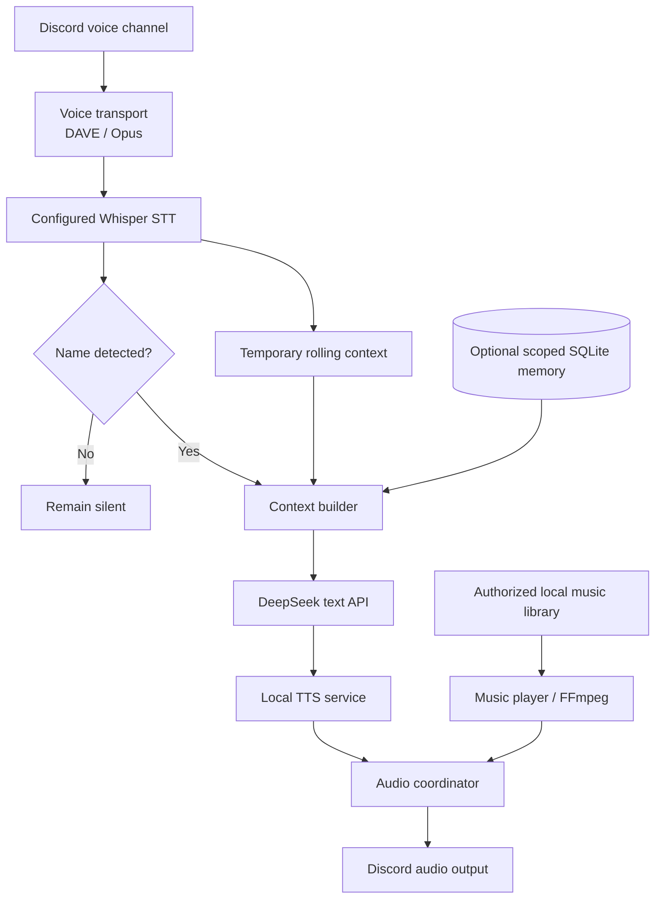

<div align="center">

# 🐟 Fat Fish Discord

### A voice-first AI companion for Discord

**Listens quietly. Speaks when called. Remembers with permission.**

A self-hosted, experimental Discord companion built around local speech recognition, DeepSeek, customizable text-to-speech, scoped memory, and a local music player.

[](docs/RELEASE_NOTES_v0.4.0-alpha.md)
[](docs/INSTALLATION.md)
[](THIRD_PARTY_NOTICES.md)

[Explore features](#what-it-can-do) · [How it works](#how-it-works) · [Get started](#getting-started) · [Privacy](#privacy-first-by-design)

</div>

---

> [!IMPORTANT]
> **Public source-only alpha — not a hosted bot or a one-click install.** This repository does not include model weights, voice references, recordings, artwork, or music. You provide and operate your own Discord bot, compatible speech services, and properly licensed assets. The published snapshot has not been certified as a production deployment.

## Meet Fat Fish

Imagine joining a voice channel and talking normally with your friends. Fat Fish can maintain a short, temporary transcript of permitted speech, but it stays silent until someone says **“大肥鱼”** (*Da Fei Yu*).

When called, it can use the recent conversation to answer once, speak through a configured voice service, and return to listening. This is a name-triggered interaction, **not** a model that reliably understands when humans want it to join in: mentions and quotations containing the name can also trigger it.

```text
You:       We could play something together tonight.
Friend:    Maybe something co-op?
You:       大肥鱼，你觉得呢？
Fat Fish:  If you're playing together, I'd start with a co-op game...
```

*Illustrative dialogue, not a recording or benchmark.*

## What it can do

| Capability | What is included | Availability |
| :-- | :-- | :-- |
| **Voice companion** | Discord voice reception, local STT, name-triggered responses, Feiyu-compatible TTS and interruption controls | Integrated; requires external models and configuration |
| **Dynamic voice channels** | `/join`, `/move`, `/leave`, `/stop`; one active voice channel per process | Implemented |
| **DeepSeek chat** | Streaming text responses, cancellation and bounded request controls | Opt-in; external API charges may apply |
| **Memory** | Temporary context plus optional scoped SQLite history, approved memories, review and deletion | Persistence off by default |
| **Text chat** | Local CLI and restricted Discord `/fish` interactions | Opt-in |
| **Current information** | Bounded optional Search/Fetch integration with source handling | Opt-in; verify provider access and results |
| **Music** | Local authorized file catalog, queue, playback commands and speech/music coordination | Implemented; live music playback not verified for this snapshot |

Fat Fish is **not** an autonomous group participant, a general-purpose agent, or a streaming-service music downloader.

## How it works



The audio coordinator keeps speech and music from competing for the same voice output. It pauses music for a spoken response and resumes playback when appropriate. No second Discord bot is required.

For a module-by-module map, see [Architecture](docs/ARCHITECTURE.md).

## Getting started

### 1. Verify the source locally — no keys or models required

You need a patched supported **Node.js** release (declared minimum `22.12.0`), npm, and **FFmpeg/FFprobe** on your PATH. Native Opus may require Python and C++ build tools.

```bash
git clone https://github.com/Tcx086/fat-fish-discord-community.git
cd fat-fish-discord-community/Luna-Discord-Bot-Full-Docker/Luna

npm ci --ignore-scripts --no-audit --no-fund
npm rebuild @discordjs/opus --no-audit --no-fund

npm run test:v02
npm run test:v03
npm run test:music
```

These commands install/test the Node-side source. They **do not** start the Discord bot, download voice models, or certify a complete GPU environment. The full suite has **491 passing tests and seven known inherited failures**; see [release notes](docs/RELEASE_NOTES_v0.4.0-alpha.md) and [test results](docs/PUBLICATION_GATE.md).

### 2. Prepare your own runtime

1. Create your own Discord application and bot token.
2. Set up a compatible local multilingual Whisper endpoint and a voice service, with assets you are authorized to use.
3. Review `Luna-Discord-Bot-Full-Docker/Luna/fat-fish.env.example` and configure credentials privately. Keep features disabled until intentionally enabled.
4. Use explicit participant/operator allowlists and review the data-processing notices before enabling transcription.
5. Follow the [Installation guide](docs/INSTALLATION.md), [Deployment boundaries](docs/DEPLOYMENT.md), and [Privacy policy](PRIVACY.md) **before** starting the bot.

> [!CAUTION]
> `npm start` and the Windows launcher are **operational commands**: they can connect to Discord or start local services. They are not installation smoke tests. The Windows launcher currently enables broad participant capture; use the manual allowlist profile where explicit participant selection is required.

## Commands at a glance

| Command | Purpose |
| :-- | :-- |
| `/join` · `/move` · `/leave` | Enter, switch, or leave an authorized voice channel |
| `/stop` · `/pause` · `/resume` | Emergency disconnect or control transcription |
| `/opt-out` · `/opt-in` | Control your own participation in transcription |
| `/fish` | Optional, allowlisted private text interaction |
| `/memory` | Optional scoped memory consent, review and deletion |
| `/music play` · `/music skip` · `/music pause` | Control tracks from an operator-authorized local library |

Available commands depend on enabled modules, configured permissions, and registration. The bot does not automatically join channels or play music in the recommended configuration.

## Privacy first, by design

Passive listening **does transcribe permitted speech before the name is detected**. The default working buffer is bounded (up to three minutes / 40 utterances); persistent history is a **separate opt-in feature**. When DeepSeek is enabled and the bot is invoked, bounded text and eligible context are sent to an external service. Raw microphone audio is not sent to DeepSeek by the documented integration.

Before using this in a real server:

- Inform participants and obtain appropriate agreement for transcription and external processing.
- Review the distinction between temporary context and persistent, scoped memory.
- Protect local storage, keys, logs, and model assets; plan retention and deletion.
- Note that `/opt-out` is **not durable across a full bot restart** in this alpha.

Read [PRIVACY.md](PRIVACY.md) for the complete data flow, controls, retention limits and operator responsibilities.

## Project status

This is an **experimental source release**. Native audio/codec and focused application tests have passed, but the public snapshot has not been independently validated as a clean-OS, complete GPU/Whisper/Feiyu install. Real Discord music playback, multi-user stability and long-duration listening are not certified. Known inherited tests remain failing. No production SLA or model-asset license is provided.

See [Release notes](docs/RELEASE_NOTES_v0.4.0-alpha.md), [Installation](docs/INSTALLATION.md), and [Security](SECURITY.md) for detailed limits.

## Credits & licensing

Fat Fish Discord is an **independent, unofficial** project derived from [smakus/Luna Discord AI Voice Chatbot](https://github.com/smakus/luna-discord-ai-voice-chatbot). The original **MIT copyright and license** remain in [LICENSE](LICENSE).

The JavaScript openWakeWord-based implementation additionally carries its applicable **Apache-2.0 notices**, copyright attribution and modification record. See [THIRD_PARTY_NOTICES.md](THIRD_PARTY_NOTICES.md) and [licenses](licenses/Apache-2.0.txt).

**Models, weights, character images, reference voices, music and other external assets have separate rights and are not included.** A project's code license does not grant rights to these assets. This project is not affiliated with or endorsed by DeepSeek, Discord or the upstream maintainers.

Contributions are welcome: start with [CONTRIBUTING.md](CONTRIBUTING.md). For vulnerabilities, use the repository's **Security → Report a vulnerability** private reporting flow rather than a public issue.

<div align="center">

---

Built to make a Discord bot feel less like a command line—and more like someone you can call into the conversation.

</div>