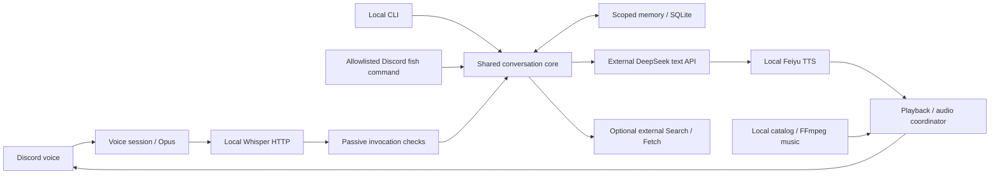

# Architecture and component overview

This integrated source includes the v0.3 voice lifecycle and v0.4 music engine.
Older version names in component documentation describe checkpoints.

Paths are relative to `Luna-Discord-Bot-Full-Docker/Luna` unless specified.

| Layer | Files | Responsibility / status |
| --- | --- | --- |
| Application | `index.js`, `config.js`, `conversation-config.js` | Discord wiring and gates. Importing the entrypoint is not a safe generic smoke check. |
| Transport | `voice-session.js`, `voice-input.js`, `voice-listen.js`, `whisper.js` | Session generations, DAVE/native Opus, bounded PCM/STT, redirect rejection. Native offline tests pass. |
| Interaction | `passive-listener.js`, `conversation-core.js`, `conversation-runtime.js`, `discord-text-adapter.js`, `local-chat.js` | Voice invocation and shared text/memory/search. Default code/launcher can accept all participants; manual profile restricts them. |
| Model | `deepseek.js`, `deepseek-config.js`, `deepseek-response.js`, `search-tools.js`, `search-synthesis.js` | Streaming, budgets, cancellation, source presentation; external text processing, no fresh live check. |
| Memory | `memory/{engine,store,context,commands,character}.js`, `schema.sql`, `v2.sql`, `character/*.md` | Temporary context; optional scoped SQLite/FTS5, consent, reviewed memories, retention/deletion. Encryption is external; production summarizer not wired. |
| Speech | `tts.js`, `voice-playback.js`, `sentences.js`; sibling `FeiyuTTS/{engine,server}.py` | Local voice, complete WAV, bounded prefetch/queue. Cancellation drains inference before reuse; timeout/failure can force cold start. |
| Shared Python service | sibling `Qwen3TTS/{cuda_server,cuda_voice}.py`, `expressions.json` | Feiyu imports queue/service utilities. Keep these even when excluding Qwen audition tools; their name does not select the Qwen voice. |
| Music | `music-{catalog,commands,engine}.js`, `audio-coordinator.js`, `now-playing.js` | Validated local files and queue; exclusive speech/music output ownership. Off by default; live verification pending. |
| Legacy | `wakeword.js`, `wake-backup.js`, `answer-llm.js`, `mcp-server.js`, `commands.js`, sibling alternate TTS wrappers | Luna compatibility; outside recommended alpha profile. Wake assets absent; MCP lacks public-network authentication. |
| Experimental | `wechat-adapter.js` | Synthetic protocol fixtures; no public callback/account deployment. |
| Operator helpers | Root launchers, `tools/windows/*`, STT/Feiyu scripts | Host-specific handling, not a complete installer. |

Memory is scoped evidence, not an unrestricted agent store. Reviewed entries can
still be wrong; permission checks do not guarantee model correctness. Music plays
operator-supplied local files. No screen observation or autonomous external action
is established. See [privacy](../PRIVACY.md), [installation](INSTALLATION.md) and
[the complete historical file provenance inventory](SOURCE_PROVENANCE.json).
